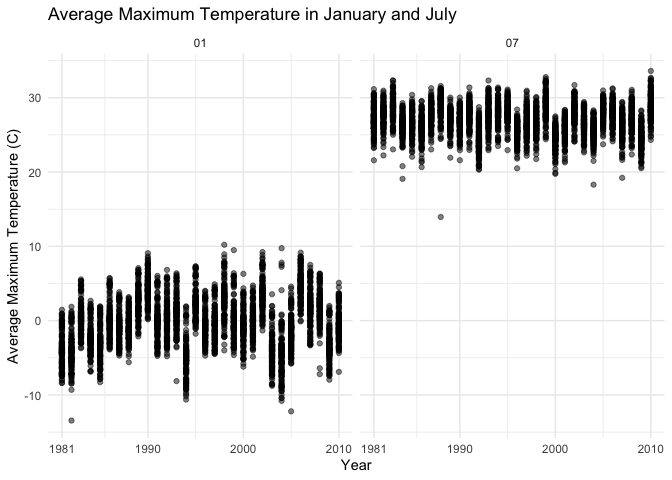
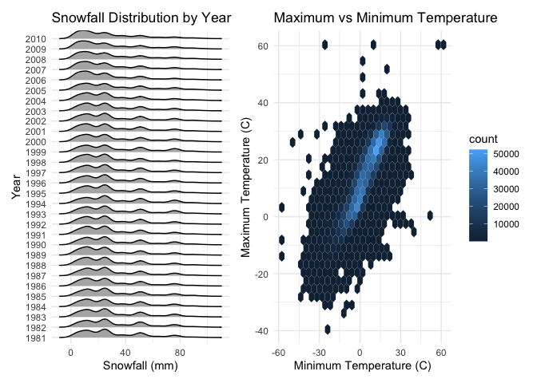
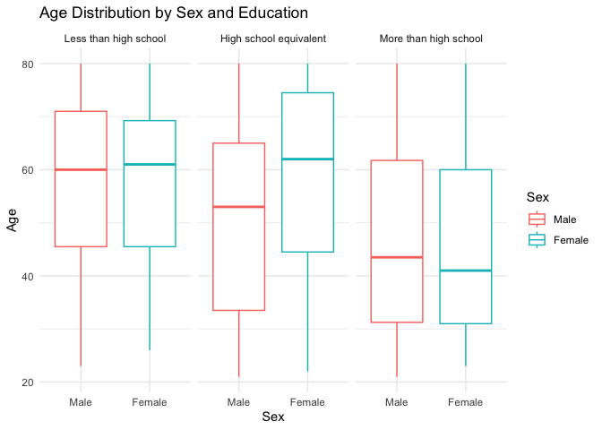
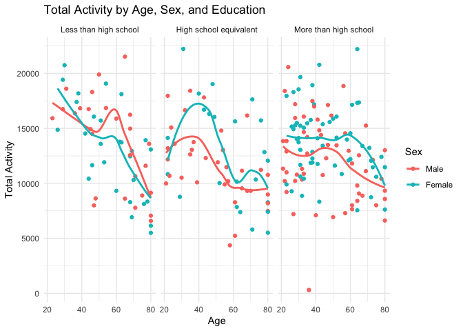
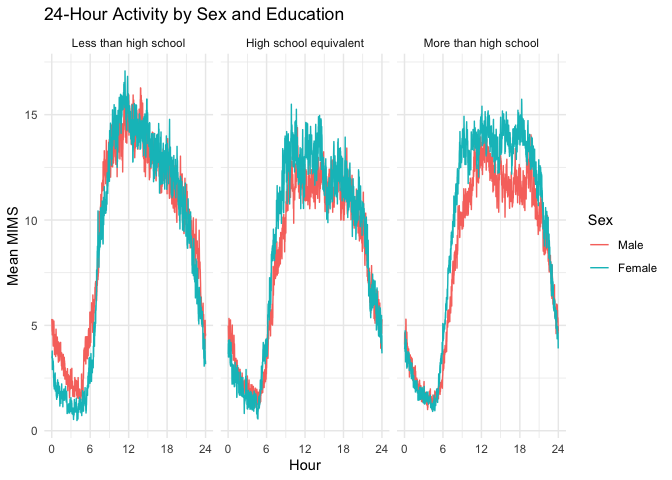
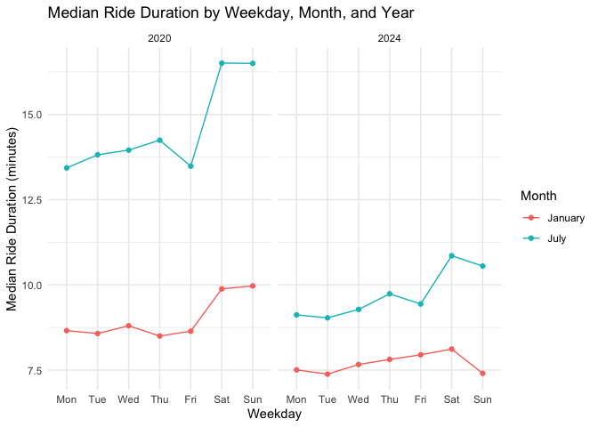
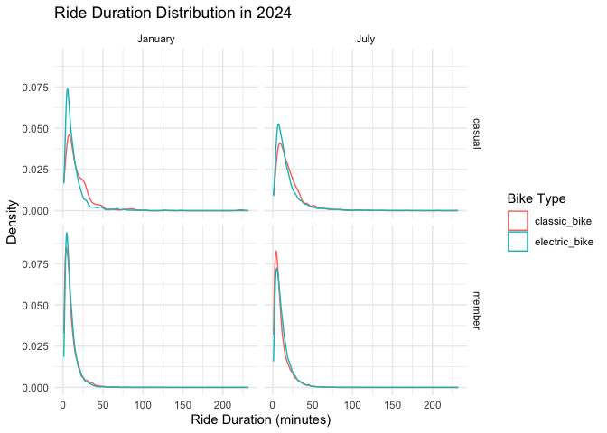

p8105_hw3_yc4959
================
Yimeng Cao
2026-10-11

This is the homework 3!

\#Problem 1 Load the NOAA data

``` r
library(patchwork)
library(ggridges)
library(tidyverse)
```

    ## ── Attaching core tidyverse packages ──────────────────────── tidyverse 2.0.0 ──
    ## ✔ dplyr     1.2.1     ✔ readr     2.2.0
    ## ✔ forcats   1.0.1     ✔ stringr   1.6.0
    ## ✔ ggplot2   4.0.3     ✔ tibble    3.3.1
    ## ✔ lubridate 1.9.5     ✔ tidyr     1.3.2
    ## ✔ purrr     1.2.2     
    ## ── Conflicts ────────────────────────────────────────── tidyverse_conflicts() ──
    ## ✖ dplyr::filter() masks stats::filter()
    ## ✖ dplyr::lag()    masks stats::lag()
    ## ℹ Use the conflicted package (<http://conflicted.r-lib.org/>) to force all conflicts to become errors

``` r
library(p8105.datasets)
```

Check the number of rows and columns. Check first 5 row of dataset to
look variables.

``` r
data("ny_noaa")
nrow(ny_noaa)
```

    ## [1] 2595176

``` r
ncol(ny_noaa)
```

    ## [1] 7

``` r
head(ny_noaa)
```

    ## # A tibble: 6 × 7
    ##   id          date        prcp  snow  snwd tmax  tmin 
    ##   <chr>       <date>     <int> <int> <int> <chr> <chr>
    ## 1 US1NYAB0001 2007-11-01    NA    NA    NA <NA>  <NA> 
    ## 2 US1NYAB0001 2007-11-02    NA    NA    NA <NA>  <NA> 
    ## 3 US1NYAB0001 2007-11-03    NA    NA    NA <NA>  <NA> 
    ## 4 US1NYAB0001 2007-11-04    NA    NA    NA <NA>  <NA> 
    ## 5 US1NYAB0001 2007-11-05    NA    NA    NA <NA>  <NA> 
    ## 6 US1NYAB0001 2007-11-06    NA    NA    NA <NA>  <NA>

Check missing values in each variable

``` r
colSums(is.na(ny_noaa))
```

    ##      id    date    prcp    snow    snwd    tmax    tmin 
    ##       0       0  145838  381221  591786 1134358 1134420

The ny_noaa dataset contains 2,595,176 observations and 7 variables.

The dataset includes station ID (id), date (date), precipitation (prcp),
snowfall (snow), snow depth (snwd), maximum temperature (tmax), and
minimum temperature (tmin).Each row represents a weather observation for
a station on a specific date.

There are no missing values in id or date. Missing data are present in
the weather variables, with 145,838 missing values in prcp, 381,221 in
snow, 591,786 in snwd, 1,134,358 in tmax, and 1,134,420 in tmin.

Missing data are big issue in this dataset, especially for the
temperature.

Separate date into year, month, and day. Then check.

``` r
ny_noaa =
  ny_noaa |>
  separate(date, into = c("year", "month", "day"), sep = "-")
```

Ensure observations for temperature, precipitation, and snowfall are
given in reasonable units. Convert temperature to Celsius.

``` r
ny_noaa =
  ny_noaa |>
  mutate(
    tmax = as.numeric(tmax) / 10,
    tmin = as.numeric(tmin) / 10
  )
```

For snowfall, what are the most commonly observed values? Why?

``` r
ny_noaa =
  ny_noaa |>
  mutate(prcp = prcp / 10)
```

According to the data description, precipitation, maximum temperature,
and minimum temperature were originally measured in tenths of their
respective units. I divided prcp, tmax, and tmin by 10 so that
precipitation is measured in millimeters and temperature is measured in
degrees Celsius. snow and snwd were already measured in millimeters.

``` r
ny_noaa |>
  count(snow) |>
  arrange(desc(n))
```

    ## # A tibble: 282 × 2
    ##     snow       n
    ##    <int>   <int>
    ##  1     0 2008508
    ##  2    NA  381221
    ##  3    25   31022
    ##  4    13   23095
    ##  5    51   18274
    ##  6    76   10173
    ##  7     8    9962
    ##  8     5    9748
    ##  9    38    9197
    ## 10     3    8790
    ## # ℹ 272 more rows

The most commonly observed snowfall value is 0 mm, with 2,008,508
observations. I think because most days do not have snowfall.

Make a two-panel plot showing the average max temperature in January and
in July in each station across years. Is there any observable /
interpretable structure? Any outliers?

Keep January and July observations

``` r
ny_noaa_jan_july =
  ny_noaa |>
  filter(month == "01" | month == "07")
```

Calculate average maximum temperature In my first attempt, I got NaN
values when calculating the mean because some stations had missing tmax
values. So I used drop_na(tmax) before calculating the average maximum
temperature.

``` r
jan_july_tmax =
  ny_noaa_jan_july |>
  drop_na(tmax) |>
  group_by(id, year, month) |>
  summarize(mean_tmax = mean(tmax))
```

    ## `summarise()` has regrouped the output.
    ## ℹ Summaries were computed grouped by id, year, and month.
    ## ℹ Output is grouped by id and year.
    ## ℹ Use `summarise(.groups = "drop_last")` to silence this message.
    ## ℹ Use `summarise(.by = c(id, year, month))` for per-operation grouping
    ##   (`?dplyr::dplyr_by`) instead.

Change year to numeric

``` r
jan_july_tmax =
  jan_july_tmax |>
  mutate(year = as.numeric(year))
```

Plot average maximum temperature in January and July

``` r
jan_july_tmax |>
  ggplot(aes(x = year, y = mean_tmax)) +
  geom_point(alpha = .5) +
  facet_grid(. ~ month) +
  labs(
    title = "Average Maximum Temperature in January and July",
    x = "Year",
    y = "Average Maximum Temperature (C)"
  ) +
  scale_x_continuous(
    breaks = c(1981, 1990, 2000, 2010)
  ) +
  theme_minimal()
```

<!-- -->

Average maximum temperatures are much lower in January than in July.
Average temperatures in January range from -10°C to 10°C, while average
temperatures in July range from 20°C to 30°C. There are some outliers.A
January value around -13°C and a July value around 14°C.

Make a two-panel plot showing (i) tmax vs tmin for the full dataset
(note that a scatterplot may not be the best option);

Remove missing temperature values

``` r
tmax_tmin =
  ny_noaa |>
  drop_na(tmax, tmin)
```

Plot maximum and minimum temperature

``` r
tmax_tmin_plot =
  tmax_tmin |>
  ggplot(aes(x = tmin, y = tmax)) +
  geom_hex() +
  labs(
    title = "Maximum vs Minimum Temperature",
    x = "Minimum Temperature (C)",
    y = "Maximum Temperature (C)"
  ) +
  theme_minimal()
```

and (ii) make a plot showing the distribution of snowfall values greater
than 0 and less than 100 separately by year.

Keep snowfall values between 0 and 100 mm Change year to a factor

``` r
snowfall_df =
  ny_noaa |>
  filter(snow > 0, snow < 100) |>
  mutate(year = factor(year))
```

Plot snowfall distribution by year

``` r
snowfall_plot =
  snowfall_df |>
  ggplot(aes(x = snow, y = year)) +
  geom_density_ridges(scale = .85) +
  labs(
    title = "Snowfall Distribution by Year",
    x = "Snowfall (mm)",
    y = "Year"
  ) +
  theme_minimal()
```

Combine the two plots

``` r
snowfall_plot + tmax_tmin_plot
```

    ## Picking joint bandwidth of 3.76

<!-- -->

\#Problem 2

Read demographic data and accelerometer data and check

I checked the first five rows of the demographic data and found that the
first four rows contain variable descriptions and coding information.
Therefore, I skipped the first four rows.

``` r
demographic_df = read_csv("./data/nhanes_covar.csv", skip = 4)
```

    ## Rows: 250 Columns: 5
    ## ── Column specification ────────────────────────────────────────────────────────
    ## Delimiter: ","
    ## dbl (5): SEQN, sex, age, BMI, education
    ## 
    ## ℹ Use `spec()` to retrieve the full column specification for this data.
    ## ℹ Specify the column types or set `show_col_types = FALSE` to quiet this message.

``` r
accelerometer_df = read_csv("./data/nhanes_accel.csv")
```

    ## Rows: 250 Columns: 1441
    ## ── Column specification ────────────────────────────────────────────────────────
    ## Delimiter: ","
    ## dbl (1441): SEQN, min1, min2, min3, min4, min5, min6, min7, min8, min9, min1...
    ## 
    ## ℹ Use `spec()` to retrieve the full column specification for this data.
    ## ℹ Specify the column types or set `show_col_types = FALSE` to quiet this message.

``` r
head(demographic_df)
```

    ## # A tibble: 6 × 5
    ##    SEQN   sex   age   BMI education
    ##   <dbl> <dbl> <dbl> <dbl>     <dbl>
    ## 1 62161     1    22  23.3         2
    ## 2 62164     2    44  23.2         3
    ## 3 62169     1    21  20.1         2
    ## 4 62174     1    80  33.9         3
    ## 5 62177     1    51  20.1         2
    ## 6 62178     1    80  28.5         2

``` r
head(accelerometer_df)
```

    ## # A tibble: 6 × 1,441
    ##    SEQN  min1  min2  min3  min4   min5   min6  min7   min8    min9  min10  min11
    ##   <dbl> <dbl> <dbl> <dbl> <dbl>  <dbl>  <dbl> <dbl>  <dbl>   <dbl>  <dbl>  <dbl>
    ## 1 62161 1.11  3.12  1.47  0.938 1.60   0.145  2.10  0.509   1.63   1.20   0.947 
    ## 2 62164 1.92  1.67  2.38  0.935 2.59   5.22   2.39  4.90    1.97   3.13   2.77  
    ## 3 62169 5.85  5.18  4.76  6.48  6.85   7.24   6.12  7.48    5.47   6.49   5.14  
    ## 4 62174 5.42  3.48  3.72  3.81  6.85   4.45   0.561 1.61    0.698  2.72   4.85  
    ## 5 62177 6.14  8.06  9.99  6.60  4.57   2.78   7.10  7.25   10.1    7.49   2.72  
    ## 6 62178 0.167 0.429 0.131 1.20  0.0796 0.0487 0.106 0.0653  0.0564 0.0639 0.0909
    ## # ℹ 1,429 more variables: min12 <dbl>, min13 <dbl>, min14 <dbl>, min15 <dbl>,
    ## #   min16 <dbl>, min17 <dbl>, min18 <dbl>, min19 <dbl>, min20 <dbl>,
    ## #   min21 <dbl>, min22 <dbl>, min23 <dbl>, min24 <dbl>, min25 <dbl>,
    ## #   min26 <dbl>, min27 <dbl>, min28 <dbl>, min29 <dbl>, min30 <dbl>,
    ## #   min31 <dbl>, min32 <dbl>, min33 <dbl>, min34 <dbl>, min35 <dbl>,
    ## #   min36 <dbl>, min37 <dbl>, min38 <dbl>, min39 <dbl>, min40 <dbl>,
    ## #   min41 <dbl>, min42 <dbl>, min43 <dbl>, min44 <dbl>, min45 <dbl>, …

Load, tidy, merge, and otherwise organize the data sets. Your final
dataset should include all originally observed variables；

exclude participants less than 21 years of age, and those with missing
demographic data

``` r
demographic_df =
  demographic_df |>
  filter(age >= 21) |>
  drop_na()
```

Tidy accelerometer data

``` r
accelerometer_df =
  accelerometer_df |>
  pivot_longer(
    min1:min1440,
    names_to = "minute",
    values_to = "MIMS"
  )
```

After knitting the document, I found that the 24-hour activity plot did
not display the time correctly because the minute variable was stored as
character values. Therefore, I further cleaned the minute variable
before the analysis.

``` r
accelerometer_df =
  accelerometer_df |>
  separate(
    minute,
    into = c("min", "minute"),
    sep = 3
  )
accelerometer_df =
  accelerometer_df |>
  mutate(minute = as.numeric(minute)) |>
  select(-min)
head(accelerometer_df)
```

    ## # A tibble: 6 × 3
    ##    SEQN minute  MIMS
    ##   <dbl>  <dbl> <dbl>
    ## 1 62161      1 1.11 
    ## 2 62161      2 3.12 
    ## 3 62161      3 1.47 
    ## 4 62161      4 0.938
    ## 5 62161      5 1.60 
    ## 6 62161      6 0.145

Merge demographic and accelerometer data

``` r
merged_df =
  left_join(demographic_df, accelerometer_df, by = "SEQN")
```

Change sex to a factor

``` r
merged_df =
  merged_df |>
  mutate(
    sex = factor(
      sex,
      levels = c(1, 2),
      labels = c("Male", "Female")
    )
  )
```

Change education to an ordered factor

``` r
merged_df =
  merged_df |>
  mutate(
    education = factor(
      education,
      levels = c(1, 2, 3),
      labels = c(
        "Less than high school",
        "High school equivalent",
        "More than high school"
      ),
      ordered = TRUE
    )
  )
```

Produce a reader-friendly table for the number of men and women in each
education category

Keep one row for each participant

``` r
participant_df =
  merged_df |>
  distinct(SEQN, sex, age, BMI, education)
```

Count participants by education and sex

``` r
participant_table =
  participant_df |>
  count(education, sex) |>
  pivot_wider(
    names_from = sex,
    values_from = n
  )
participant_table
```

    ## # A tibble: 3 × 3
    ##   education               Male Female
    ##   <ord>                  <int>  <int>
    ## 1 Less than high school     27     28
    ## 2 High school equivalent    35     23
    ## 3 More than high school     56     59

create a visualization of the age distributions for men and women in
each education category

Plot age distributions by sex and education

``` r
participant_df |>
  ggplot(aes(x = sex, y = age, color = sex)) +
  geom_boxplot() +
  facet_grid(. ~ education) +
  labs(
    title = "Age Distribution by Sex and Education",
    x = "Sex",
    y = "Age",
    color = "Sex"
  ) +
  theme_minimal()
```

<!-- -->

In the “less than high school” and “more than high school” groups, the
number of males and females is about the same. In the “high school
equivalent” group, there are more males than females.

The age distribution shows that participants with less than high school
education are generally older, while participants with more than high
school education are generally younger.

In the “high school equivalent” group, females are generally older than
males.

Calculate total activity for each participant

``` r
total_activity_df =
  merged_df |>
  group_by(SEQN, sex, age, education) |>
  summarize(total_activity = sum(MIMS))
```

    ## `summarise()` has regrouped the output.
    ## ℹ Summaries were computed grouped by SEQN, sex, age, and education.
    ## ℹ Output is grouped by SEQN, sex, and age.
    ## ℹ Use `summarise(.groups = "drop_last")` to silence this message.
    ## ℹ Use `summarise(.by = c(SEQN, sex, age, education))` for per-operation
    ##   grouping (`?dplyr::dplyr_by`) instead.

Plot these total activities (y-axis) against age (x-axis); your plot
should compare men to women and have separate panels for each education
level. Include a trend line or a smooth.

Plot total activity against age

``` r
total_activity_df |>
  ggplot(aes(x = age, y = total_activity, color = sex)) +
  geom_point() +
  geom_smooth(se = FALSE) +
  facet_grid(. ~ education) +
  labs(
    title = "Total Activity by Age, Sex, and Education",
    x = "Age",
    y = "Total Activity",
    color = "Sex"
  ) +
  theme_minimal()
```

    ## `geom_smooth()` using method = 'loess' and formula = 'y ~ x'

<!-- -->

In all three education groups, total activity decreases as people get
older. There are some differences between males and females, but the
pattern is different in each group. Overall, older participants have
lower total activity than younger participants.

Make a three-panel plot that shows the 24-hour activity time courses for
each education level and use color to indicate sex.

Calculate average activity for each minute

``` r
activity_time_df =
  merged_df |>
  group_by(education, sex, minute) |>
  summarize(mean_MIMS = mean(MIMS)) |>
  ungroup()
```

    ## `summarise()` has regrouped the output.
    ## ℹ Summaries were computed grouped by education, sex, and minute.
    ## ℹ Output is grouped by education and sex.
    ## ℹ Use `summarise(.groups = "drop_last")` to silence this message.
    ## ℹ Use `summarise(.by = c(education, sex, minute))` for per-operation grouping
    ##   (`?dplyr::dplyr_by`) instead.

Plot 24-hour activity time courses

``` r
activity_time_df |>
  ggplot(aes(x = minute, y = mean_MIMS, color = sex)) +
  geom_line() +
  facet_grid(. ~ education) +
  scale_x_continuous(
    breaks = c(0, 360, 720, 1080, 1440),
    labels = c("0", "6", "12", "18", "24")
  ) +
  labs(
    title = "24-Hour Activity by Sex and Education",
    x = "Hour",
    y = "Mean MIMS",
    color = "Sex"
  ) +
  theme_minimal()
```

<!-- -->

Activity is low at night. It goes up quickly in the morning, stays high
during the day, and goes down in the evening. The daily pattern is
similar in all three education groups. There are some differences
between males and females. In the “more than high school” group, females
usually have more activity during the day.

\#Problem 3 Read Citi Bike data

``` r
jan_2020_df = read_csv("./data/Jan 2020 Citi.csv")
```

    ## Rows: 12420 Columns: 7
    ## ── Column specification ────────────────────────────────────────────────────────
    ## Delimiter: ","
    ## chr (6): ride_id, rideable_type, weekdays, start_station_name, end_station_n...
    ## dbl (1): duration
    ## 
    ## ℹ Use `spec()` to retrieve the full column specification for this data.
    ## ℹ Specify the column types or set `show_col_types = FALSE` to quiet this message.

``` r
july_2020_df = read_csv("./data/July 2020 Citi.csv")
```

    ## Rows: 21048 Columns: 7
    ## ── Column specification ────────────────────────────────────────────────────────
    ## Delimiter: ","
    ## chr (6): ride_id, rideable_type, weekdays, start_station_name, end_station_n...
    ## dbl (1): duration
    ## 
    ## ℹ Use `spec()` to retrieve the full column specification for this data.
    ## ℹ Specify the column types or set `show_col_types = FALSE` to quiet this message.

``` r
jan_2024_df = read_csv("./data/Jan 2024 Citi.csv")
```

    ## Rows: 18861 Columns: 7
    ## ── Column specification ────────────────────────────────────────────────────────
    ## Delimiter: ","
    ## chr (6): ride_id, rideable_type, weekdays, start_station_name, end_station_n...
    ## dbl (1): duration
    ## 
    ## ℹ Use `spec()` to retrieve the full column specification for this data.
    ## ℹ Specify the column types or set `show_col_types = FALSE` to quiet this message.

``` r
july_2024_df = read_csv("./data/July 2024 Citi.csv")
```

    ## Rows: 47156 Columns: 7
    ## ── Column specification ────────────────────────────────────────────────────────
    ## Delimiter: ","
    ## chr (6): ride_id, rideable_type, weekdays, start_station_name, end_station_n...
    ## dbl (1): duration
    ## 
    ## ℹ Use `spec()` to retrieve the full column specification for this data.
    ## ℹ Specify the column types or set `show_col_types = FALSE` to quiet this message.

Check Citi Bike data

``` r
head(jan_2020_df)
```

    ## # A tibble: 6 × 7
    ##   ride_id    rideable_type weekdays duration start_station_name end_station_name
    ##   <chr>      <chr>         <chr>       <dbl> <chr>              <chr>           
    ## 1 4BE06CB33… classic_bike  Tuesday     15.3  Columbus Ave & W … E 53 St & Madis…
    ## 2 26886E034… classic_bike  Wednesd…     5.31 2 Ave & E 96 St    1 Ave & E 110 St
    ## 3 24DC56060… classic_bike  Friday       9.69 Columbia St & Riv… Grand St & Eliz…
    ## 4 EEDC10535… classic_bike  Sunday       7.00 W 84 St & Columbu… Columbus Ave & …
    ## 5 2CD4BD4CE… classic_bike  Friday       2.85 Forsyth St & Broo… Suffolk St & St…
    ## 6 E18682F9A… classic_bike  Sunday      25.5  Allen St & Hester… Atlantic Ave & …
    ## # ℹ 1 more variable: member_casual <chr>

``` r
head(july_2020_df)
```

    ## # A tibble: 6 × 7
    ##   ride_id    rideable_type weekdays duration start_station_name end_station_name
    ##   <chr>      <chr>         <chr>       <dbl> <chr>              <chr>           
    ## 1 A7503F194… classic_bike  Sunday       9.86 Franklin Ave & Em… Grand Army Plaz…
    ## 2 B47EBE0EA… classic_bike  Monday       8.29 E 33 St & 1 Ave    E 33 St & 5 Ave 
    ## 3 8146F6C68… classic_bike  Wednesd…     5.39 George St & Wilso… Willoughby Ave …
    ## 4 D49560E33… classic_bike  Saturday    19.2  St. Nicholas Ave … Willis Ave & E …
    ## 5 87687AAE4… classic_bike  Tuesday     26.4  Front St & Jay St  Grand St & Eliz…
    ## 6 E30DFCD98… classic_bike  Sunday      51.9  Clinton St & Jora… Myrtle Ave & Li…
    ## # ℹ 1 more variable: member_casual <chr>

``` r
head(jan_2024_df)
```

    ## # A tibble: 6 × 7
    ##   ride_id    rideable_type weekdays duration start_station_name end_station_name
    ##   <chr>      <chr>         <chr>       <dbl> <chr>              <chr>           
    ## 1 644A0105A… electric_bike Wednesd…    16.5  Lafayette St & Je… W 50 St & 9 Ave 
    ## 2 A5A8C0AD1… electric_bike Wednesd…     6.29 Clinton St & Till… Duffield St & W…
    ## 3 B392CE349… electric_bike Tuesday      6.12 West End Ave & W … W 116 St & Broa…
    ## 4 33756EDC7… electric_bike Wednesd…    10.9  Grand St & Elizab… Front St & Jay …
    ## 5 29D9AF64D… electric_bike Thursday     8.42 12 Ave & W 40 St   Washington St &…
    ## 6 C7E61191A… electric_bike Sunday      18.5  7 Ave & Central P… 44 Dr & Jackson…
    ## # ℹ 1 more variable: member_casual <chr>

``` r
head(july_2024_df)
```

    ## # A tibble: 6 × 7
    ##   ride_id    rideable_type weekdays duration start_station_name end_station_name
    ##   <chr>      <chr>         <chr>       <dbl> <chr>              <chr>           
    ## 1 86AE148E3… classic_bike  Sunday      19.7  Picnic Point       Yankee Ferry Te…
    ## 2 FCF07A30F… electric_bike Thursday     7.68 W 54 St & 9 Ave    W 42 St & 8 Ave 
    ## 3 D8397E843… classic_bike  Thursday    24.5  12 Ave & W 40 St   W 84 St & Amste…
    ## 4 E575690C1… electric_bike Tuesday      3.53 Grand St & Haveme… S 4 St & Rodney…
    ## 5 184AABED4… electric_bike Wednesd…    24.1  Broadway & Kent A… Henry St & Degr…
    ## 6 ACA61A92B… classic_bike  Saturday     7.83 E 1 St & 1 Ave     Mercer St & Spr…
    ## # ℹ 1 more variable: member_casual <chr>

Add year and month

``` r
jan_2020_df =
  jan_2020_df |>
  mutate(
    year = 2020,
    month = "January"
  )

july_2020_df =
  july_2020_df |>
  mutate(
    year = 2020,
    month = "July"
  )

jan_2024_df =
  jan_2024_df |>
  mutate(
    year = 2024,
    month = "January"
  )

july_2024_df =
  july_2024_df |>
  mutate(
    year = 2024,
    month = "July"
  )
```

Combine Citi Bike data

``` r
citi_df =
  bind_rows(
    jan_2020_df,
    july_2020_df,
    jan_2024_df,
    july_2024_df
  )
head(citi_df)
```

    ## # A tibble: 6 × 9
    ##   ride_id    rideable_type weekdays duration start_station_name end_station_name
    ##   <chr>      <chr>         <chr>       <dbl> <chr>              <chr>           
    ## 1 4BE06CB33… classic_bike  Tuesday     15.3  Columbus Ave & W … E 53 St & Madis…
    ## 2 26886E034… classic_bike  Wednesd…     5.31 2 Ave & E 96 St    1 Ave & E 110 St
    ## 3 24DC56060… classic_bike  Friday       9.69 Columbia St & Riv… Grand St & Eliz…
    ## 4 EEDC10535… classic_bike  Sunday       7.00 W 84 St & Columbu… Columbus Ave & …
    ## 5 2CD4BD4CE… classic_bike  Friday       2.85 Forsyth St & Broo… Suffolk St & St…
    ## 6 E18682F9A… classic_bike  Sunday      25.5  Allen St & Hester… Atlantic Ave & …
    ## # ℹ 3 more variables: member_casual <chr>, year <dbl>, month <chr>

Check year and month

``` r
citi_df |>
  count(year, month)
```

    ## # A tibble: 4 × 3
    ##    year month       n
    ##   <dbl> <chr>   <int>
    ## 1  2020 January 12420
    ## 2  2020 July    21048
    ## 3  2024 January 18861
    ## 4  2024 July    47156

Check the size of the combined data

``` r
nrow(citi_df)
```

    ## [1] 99485

``` r
ncol(citi_df)
```

    ## [1] 9

The combined Citi Bike dataset has 99,485 rides and 9 variables. The
data comes from January and July in both 2020 and 2024. These variables
are ride ID, bike type, weekday, ride duration, start and end station
names, membership type, year, and month.

Produce a reader-friendly table showing the total number of rides in
each combination of year and month separating casual riders and Citi
Bike members. Comment on these results.

Create a reader-friendly table

``` r
ride_count_df =
  citi_df |>
  count(year, month, member_casual)

ride_count_table =
  ride_count_df |>
  pivot_wider(
    names_from = member_casual,
    values_from = n
  )
ride_count_table
```

    ## # A tibble: 4 × 4
    ##    year month   casual member
    ##   <dbl> <chr>    <int>  <int>
    ## 1  2020 January    984  11436
    ## 2  2020 July      5637  15411
    ## 3  2024 January   2108  16753
    ## 4  2024 July     10894  36262

There are more member rides than casual rides in all four groups.
January 2020 has fewer casual rides than the other groups, while July
2024 has more member rides.

Make a table showing the 5 most popular starting stations for July 2024;
include the number of rides originating from these stations.

Keep rides from July 2024

``` r
july_2024 =
  citi_df |>
  filter(year == 2024, month == "July")
```

Count 5 most popular starting station

``` r
july_2024 |>
  count(start_station_name) |>
  arrange(desc(n)) |>
  head(5)
```

    ## # A tibble: 5 × 2
    ##   start_station_name           n
    ##   <chr>                    <int>
    ## 1 Pier 61 at Chelsea Piers   163
    ## 2 University Pl & E 14 St    155
    ## 3 W 21 St & 6 Ave            152
    ## 4 West St & Chambers St      150
    ## 5 W 31 St & 7 Ave            146

These are the top five starting stations in July 2024.

Make a plot to investigate the effects of day of the week, month, and
year on median ride duration. This plot can include one or more panels,
but should facilitate comparison across all variables of interest.
Comment on your observations from this plot.

Calculate median ride duration

``` r
median_duration_df =
  citi_df |>
  group_by(year, month, weekdays) |>
  summarize(median_duration = median(duration)) |>
  ungroup()
```

    ## `summarise()` has regrouped the output.
    ## ℹ Summaries were computed grouped by year, month, and weekdays.
    ## ℹ Output is grouped by year and month.
    ## ℹ Use `summarise(.groups = "drop_last")` to silence this message.
    ## ℹ Use `summarise(.by = c(year, month, weekdays))` for per-operation grouping
    ##   (`?dplyr::dplyr_by`) instead.

Order weekdays I changed the weekday labels to shorter names to make the
x-axis easier to read.

``` r
median_duration_df =
  median_duration_df |>
  mutate(
    weekdays = factor(
      weekdays,
      levels = c(
        "Monday", "Tuesday", "Wednesday", "Thursday",
        "Friday", "Saturday", "Sunday"
      ),
      labels = c(
        "Mon", "Tue", "Wed", "Thu",
        "Fri", "Sat", "Sun"
      ),
      ordered = TRUE
    )
  )
```

``` r
median_duration_df |>
  ggplot(aes(x = weekdays, y = median_duration, color = month, group = month)) +
  geom_point() +
  geom_line() +
  facet_grid(. ~ year) +
  labs(
    title = "Median Ride Duration by Weekday, Month, and Year",
    x = "Weekday",
    y = "Median Ride Duration (minutes)",
    color = "Month"
  ) +
  theme_minimal()
```

<!-- -->

Median ride duration is higher in July than in January for both years.
Ride duration is also generally higher in 2020 than in 2024. Weekend
rides, especially on Saturday and Sunday, tend to have longer median
durations than weekday rides.

There were relatively few electric Citi Bikes in 2020, but many more are
available now. For data in 2024, make a figure that shows the impact of
month, membership status, and bike type on the distribution of ride
duration. Comment on your results.

Keep rides from 2024 and check bike types

``` r
citi_2024 =
  citi_df |>
  filter(year == 2024)
citi_2024 |>
  count(rideable_type)
```

    ## # A tibble: 2 × 2
    ##   rideable_type     n
    ##   <chr>         <int>
    ## 1 classic_bike  23006
    ## 2 electric_bike 43011

Plot ride duration distributions in 2024

``` r
citi_2024 |>
  ggplot(aes(x = duration, color = rideable_type)) +
  geom_density() +
  facet_grid(member_casual ~ month) +
  labs(
    title = "Ride Duration Distribution in 2024",
    x = "Ride Duration (minutes)",
    y = "Density",
    color = "Bike Type"
  ) +
  theme_minimal()
```

<!-- -->

In all groups, ride duration is right-skewed. This means most rides are
short. Casual riders have a wider range of ride times than members,
mostly in July. The patterns for classic bikes and electric bikes are
about the same.
